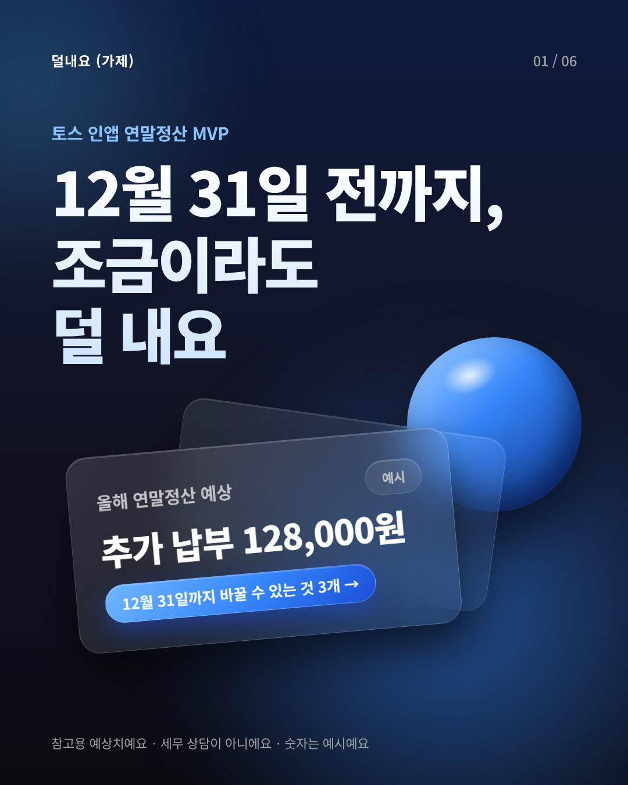
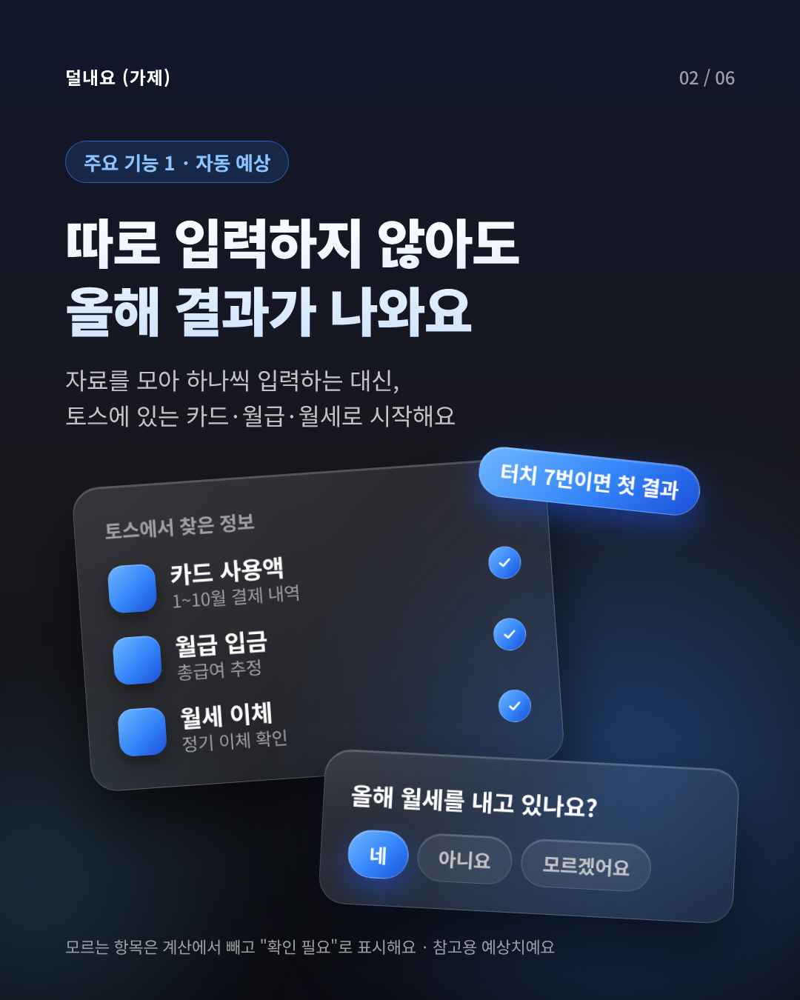
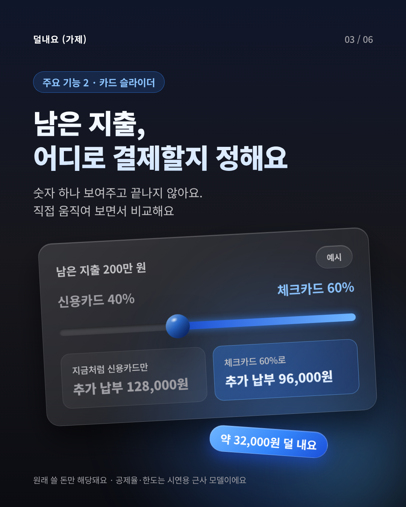
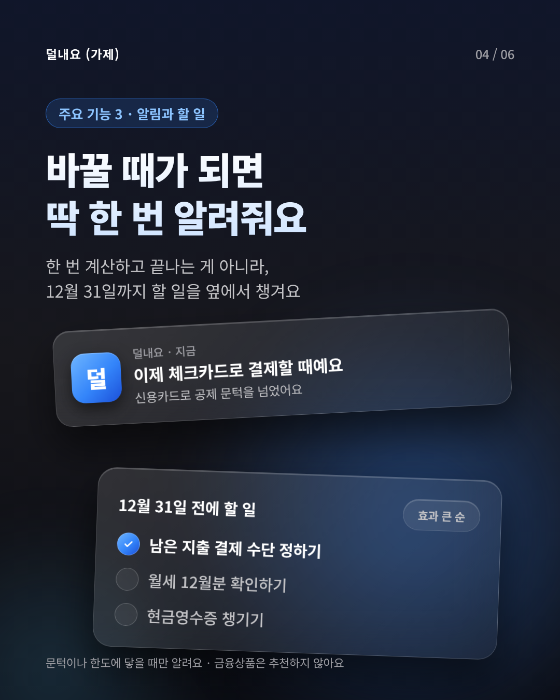
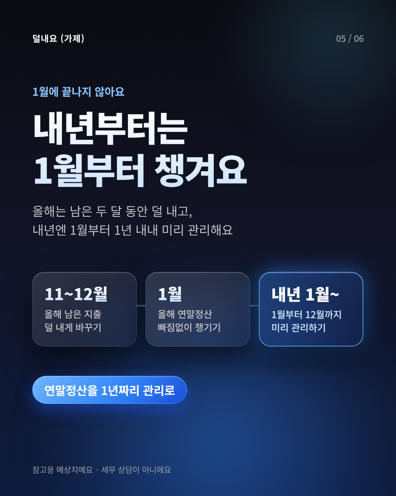
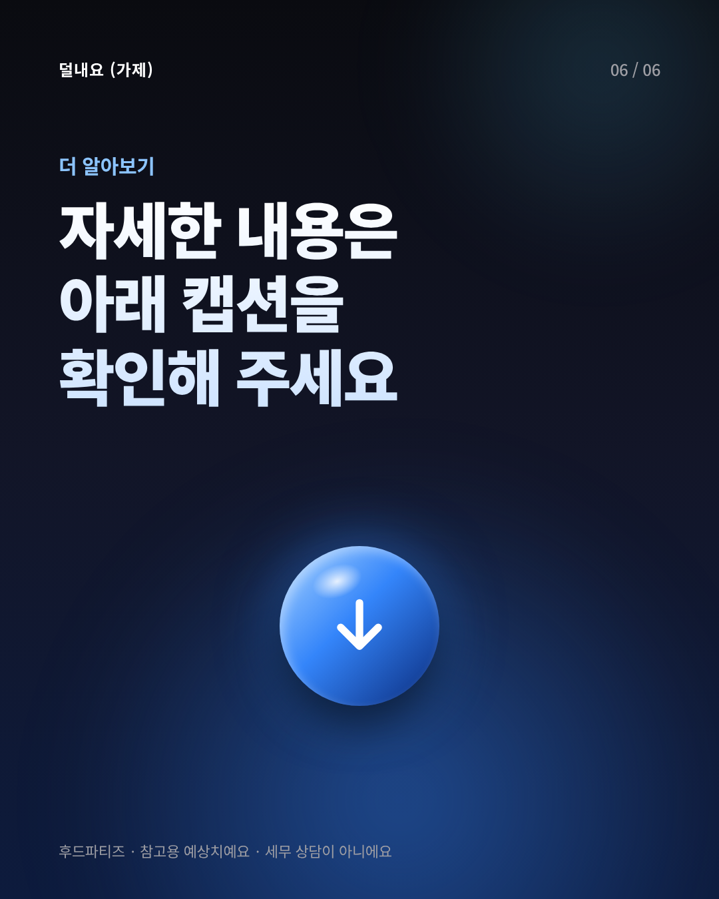

# 카드뉴스 v2 · 다크 — 덜내요 주요 기능

- **작성일:** 2026-11-10
- **규격:** 1080×1350 (인스타그램 피드 4:5), 6장
- **원본 디자인 (Figma):** [카드뉴스 · 덜내요 연말정산 MVP](https://www.figma.com/design/gkXInHEchBYZsA8S1uhR9J) — `카드뉴스 v2 · 다크` 프레임
- **웹 버전:** [`index.html`](index.html) — 브라우저로 열면 6장을 한 번에 볼 수 있어요. `?raw`를 붙이면 원본 크기로 보여요.
- **이미지:** [`images/`](images/) — 업로드용 PNG 6장

## 미리보기

| 01 표지 | 02 자동 예상 | 03 카드 슬라이더 |
|---|---|---|
|  |  |  |
| **04 알림과 할 일** | **05 메인 메시지** | **06 마무리** |
|  |  |  |

## 카드별 카피

| # | 역할 | 메인 카피 | 보조 카피 |
|---|---|---|---|
| 01 | 표지 | 12월 31일 전까지, 조금이라도 덜 내요 | 올해 연말정산 예상 카드 (숫자는 예시) |
| 02 | 주요 기능 1 · 자동 예상 | 따로 입력하지 않아도 올해 결과가 나와요 | 자료를 모아 하나씩 입력하는 대신, 토스에 있는 카드·월급·월세로 시작해요 |
| 03 | 주요 기능 2 · 카드 슬라이더 | 남은 지출, 어디로 결제할지 정해요 | 숫자 하나 보여주고 끝나지 않아요. 직접 움직여 보면서 비교해요 |
| 04 | 주요 기능 3 · 알림과 할 일 | 바꿀 때가 되면 딱 한 번 알려줘요 | 한 번 계산하고 끝나는 게 아니라, 12월 31일까지 할 일을 옆에서 챙겨요 |
| 05 | 메인 메시지 | 내년부터는 1월부터 챙겨요 | 11~12월 덜 내게 바꾸기 → 1월 연말정산 챙기기 → 내년 1월부터 1년 내내 미리 관리 |
| 06 | 마무리 | 자세한 내용은 아래 캡션을 확인해 주세요 | — |

## 게시글 캡션 초안

```
💸 연말정산 미리보기, 올해도 추가 납부였나요?

덜내요는 토스에 연결된 카드·월급·월세로 올해 연말정산을 미리 예상하는 서비스예요.

✔️ 따로 입력하지 않아도 터치 몇 번이면 올해 예상 결과가 나와요
✔️ 남은 지출을 신용·체크카드로 나눠 보며 직접 비교해요
✔️ 결제 수단을 바꿀 때가 되면 딱 한 번 알려줘요

11~12월엔 남은 지출을 덜 내게 바꾸고,
1월엔 연말정산을 빠짐없이 챙기고,
내년부터는 1월부터 1년 내내 미리 관리해요.

※ 모든 금액은 참고용 예상치이며, 세무 상담이 아니에요.
```

## 디자인 메모

- **기준:** `docs/design/toss-design-system.md`(main 브랜치)의 다크 팔레트·토스 블루(`#3485FA`)·해요체
- **요청에 따라 바꾼 점:** 토스 규칙은 그라데이션·입체 효과를 거의 쓰지 않지만, 이번 버전은 다크모드 + 그라데이션 + 반투명 유리 카드·그림자·구로 입체감을 줬어요.
- **차별점:** "다른 곳과 다른 점" 같은 문장 대신 각 카드 설명에 녹였어요(입력 없이 시작 / 직접 움직여 비교 / 12월 31일까지 이어서 챙김). 출처는 `docs/시장분석/`의 3C·전략 문장.
- **폰트:** Figma 원본은 Noto Sans KR. 웹 버전은 Pretendard가 있으면 Pretendard, 없으면 Noto Sans KR로 보여요.
- **표현 원칙:** 모든 금액은 예시·예상치, 세무 상담 아님, 금융상품 추천 안 함, 추가 소비 유도 안 함.
