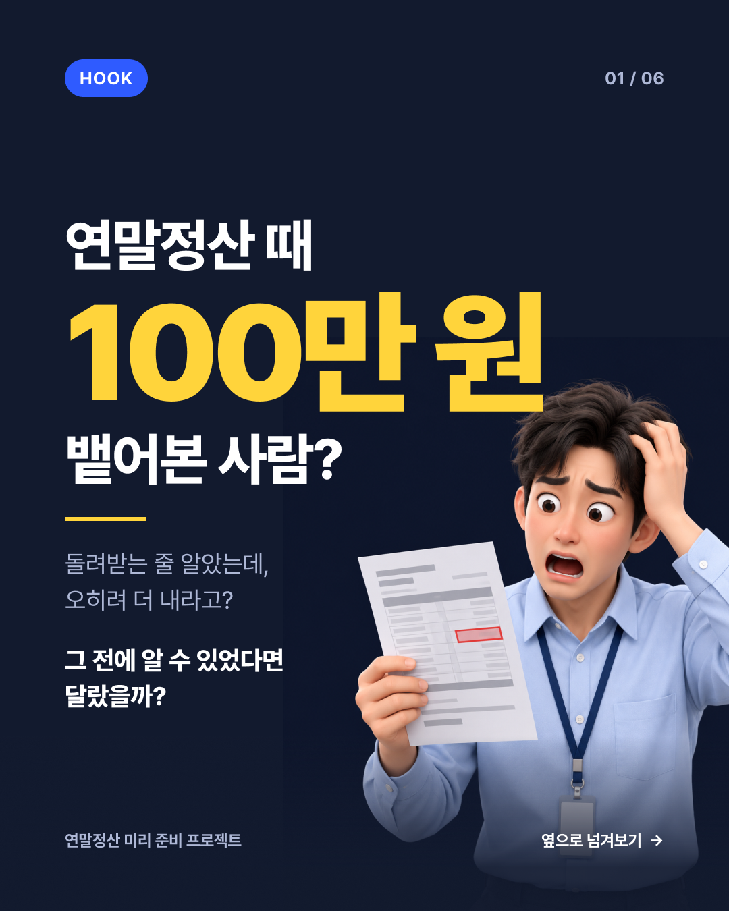
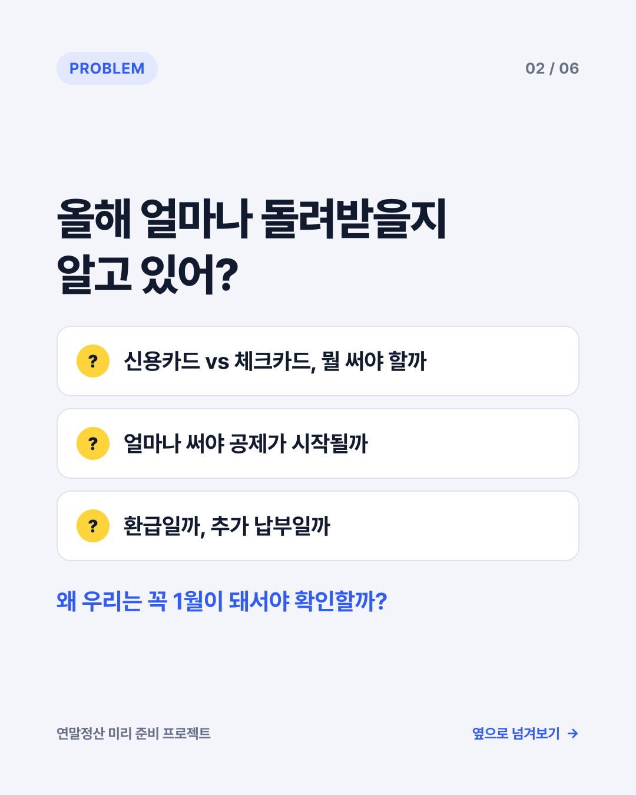
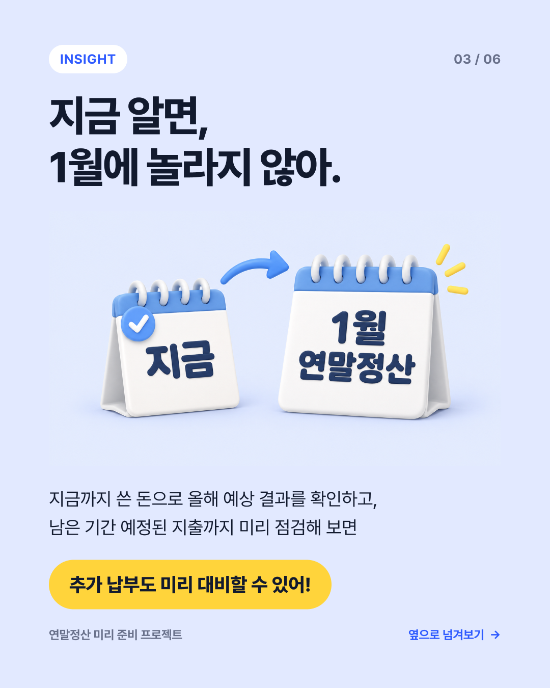
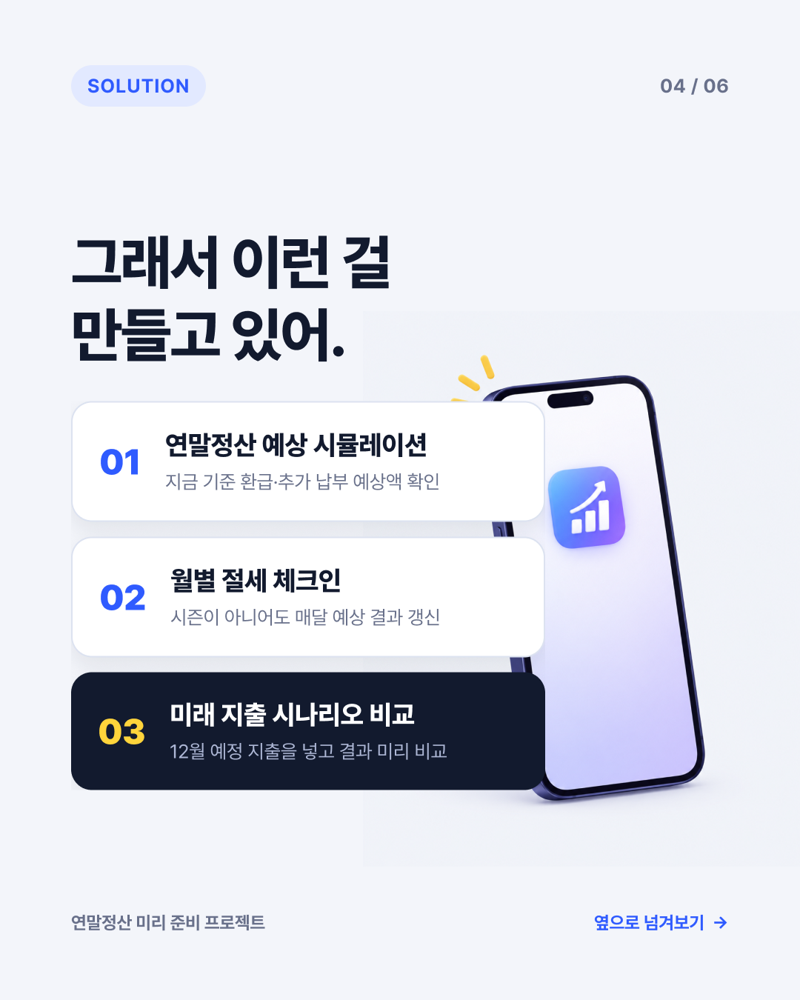
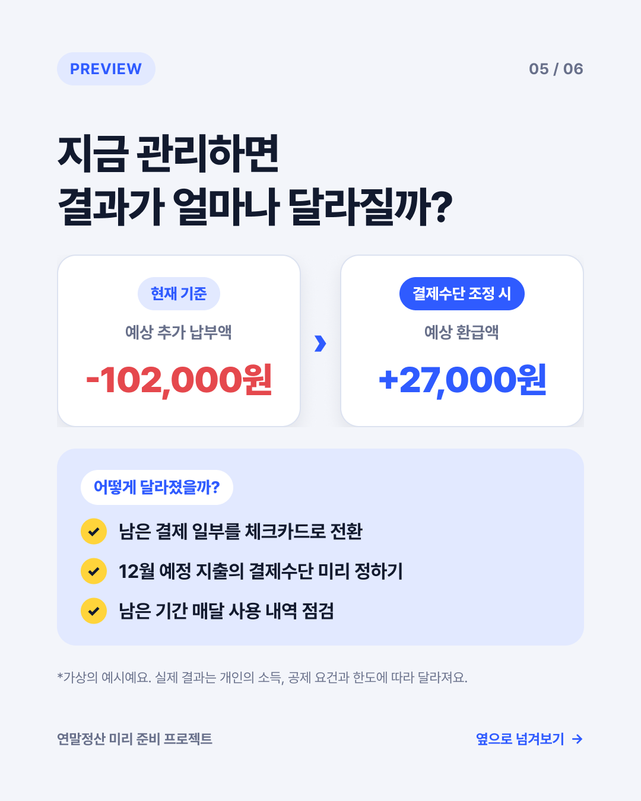
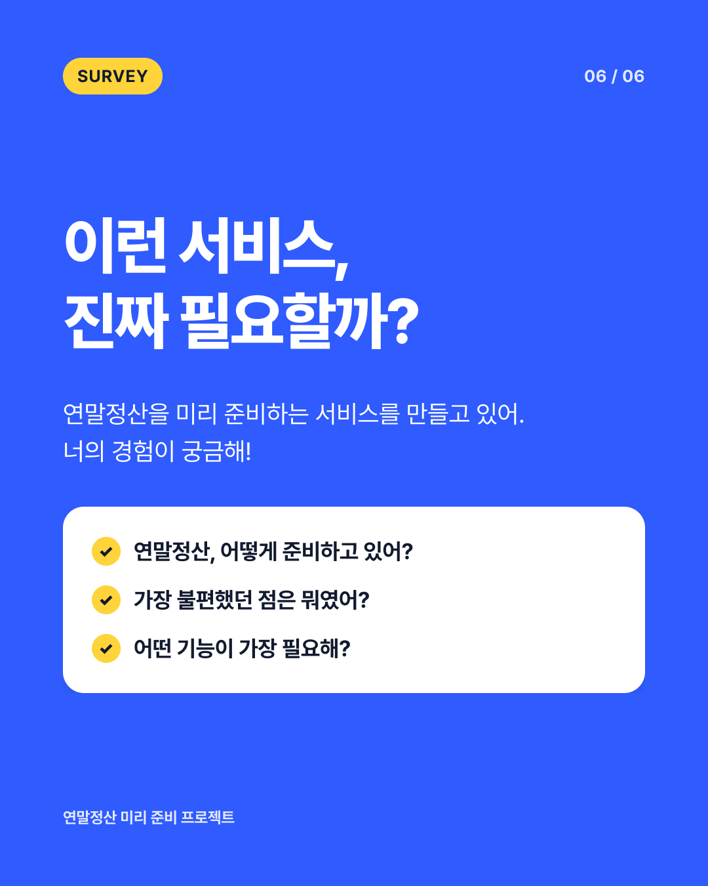

# 카드뉴스 초안 v1 — 사용자 조사용 인스타그램 캐러셀

- **작성일:** 2026-11-05
- **상태:** 초안 (Draft)
- **목적:** 카드뉴스로 관심을 끌고, 게시글 본문의 설문 링크로 연결해 문제·기능 수요를 검증하고 베타테스터 이메일을 모은다.
- **원본 디자인 (Figma):** [카드뉴스 · 연말정산 사전 관리 서비스](https://www.figma.com/design/hTHKAWSlXtiwkVkze2sR8Z)
- **규격:** 1080×1350 (인스타그램 피드 4:5), 6장
- **관련 문서:** [PRD v2](../../intent/2026-11-09-year-end-tax-toss-inapp/prd.md)
- **인터랙티브 버전:** [`카드뉴스.html`](카드뉴스.html) — 드래그·스와이프로 넘기고, 카드 위에 마우스를 올리면 요소가 움직이는 웹 프리뷰 (`img/` 폴더와 함께 열기)

> `images/` 폴더의 PNG는 v1 시점 이미지야. 최신 수정사항(1번 보조문구 삭제, '옆으로 넘겨보기' 삭제 → 오른쪽 그림자 힌트, 호버 애니메이션)은 `카드뉴스.html`에 반영돼 있어.

## 미리보기

| 01 HOOK | 02 PROBLEM | 03 INSIGHT |
|---|---|---|
|  |  |  |
| **04 SOLUTION** | **05 PREVIEW** | **06 SURVEY** |
|  |  |  |

## 카드별 카피

| # | 역할 | 메인 카피 | 보조 카피 |
|---|---|---|---|
| 01 | HOOK | 연말정산 때 **100만 원** 뱉어본 사람? | 그 전에 알 수 있었다면 달랐을까? |
| 02 | PROBLEM | 올해 얼마나 돌려받을지 알고 있어? | 신용카드 vs 체크카드 · 공제 시작 기준 · 환급 vs 추가 납부 / 왜 우리는 꼭 1월이 돼서야 확인할까? |
| 03 | INSIGHT | 지금 알면, 1월에 놀라지 않아. | 지금까지 쓴 돈으로 예상 결과를 확인하고 남은 지출을 점검 → **추가 납부도 미리 대비할 수 있어!** |
| 04 | SOLUTION | 그래서 이런 걸 만들고 있어. | ① 연말정산 예상 시뮬레이션 ② 월별 절세 체크인 ③ 미래 지출 시나리오 비교 |
| 05 | PREVIEW | 지금 관리하면 결과가 얼마나 달라질까? | 현재 기준 -102,000원 → 결제수단 조정 시 +27,000원 (가상의 예시) |
| 06 | SURVEY | 이런 서비스, 진짜 필요할까? | 연말정산 준비 방식 · 불편했던 점 · 필요한 기능 |

## 게시글 본문 초안

```
💸 연말정산 때 예상치 못한 세금 폭탄 맞아본 적 있어?

매년 돌아오는 연말정산.
신용카드와 체크카드는 어떻게 써야 하는지,
얼마나 돌려받거나 더 낼지 궁금했던 적 없었어?

우리는 연말정산 결과를 미리 예측하고,
매달 점검할 수 있는 서비스를 기획하고 있어.

그런데 정말 사람들이 이런 서비스를 필요로 할까?

📋 1분만 투자해서 너의 경험을 알려줘!
설문 참여 👉 [설문 링크]

✉️ 마지막에 이메일을 남기면 베타테스트 소식을 가장 먼저 전해줄게!
(현재 기획 단계이며, 이메일 입력은 선택사항이야.)
```

> 인스타그램 피드는 본문 URL이 클릭되지 않으므로 프로필 링크 또는 스토리 링크 스티커로 연결한다.

## 설문 구성 (안)

1. 연말정산 경험이 있나요? (있다 / 없다 → 없으면 "걱정되는 점" 문항으로 분기)
2. 홈택스 '연말정산 미리보기'를 써본 적 있나요?
3. 가장 불편했던 점은? (복수 선택 + 기타)
4. 미리 세금을 예측하고 지출 계획을 비교할 수 있다면 사용하겠나요?
5. 어떤 기능이 가장 필요한가요? (예상 시뮬레이션 / 월별 체크인 / 지출 시나리오)
6. (선택) 베타테스트 안내용 이메일 — 수집 목적·보유기간·거부 권리·삭제 방법 고지, 설문 응답과 분리

## 디자인 메모

- **컬러:** 블루(`#2F5BFF`) 메인 + 네이비(`#121A2E`) + 노랑 포인트(`#FFD43B`). Figma `CardNews/Blue` 색상 변수로 관리
- **폰트:** Pretendard
- **일러스트:** 1·3·4번은 Figma AI로 생성한 3D 일러스트
- **표현 원칙 (PRD 6.5):** 소비를 절세로 오인시키지 않도록 '절약' 대신 '예측·대비' 중심으로 작성. 5번 금액은 가상의 예시임을 명시

## 인터랙션 메모

- 넘김 힌트: '옆으로 넘겨보기' 텍스트 대신 카드 오른쪽 끝의 옅은 그림자
- 호버: 2번 질문 카드·4번 기능 카드(오른쪽으로 밀림 + 블루 테두리), 5번 금액 박스(위로 떠오름), 5·6번 체크 항목(배경 강조), 일러스트(살짝 움직임)
- 진입 효과: 장이 바뀔 때 100만 원 팝, 일러스트 등장, 5번 금액 카운트업

## 남은 할 일

- [ ] 하단 브랜드명("연말정산 미리 준비 프로젝트")을 실제 서비스명으로 교체
- [ ] 6번 태그(SURVEY) 문구 확정
- [ ] 설문 폼 제작 후 게시글 링크 삽입
- [ ] 채널별 UTM/숨은 필드로 유입 경로 구분
